# XoL Pricing Tool — user manual

Version 0.6 · 22 October 2026 · screenshots taken on the owner's laptop (Windows 11, Alteryx Designer 2026.2,
Excel 365) during a full run on the synthetic portfolio.

The tool prices excess-of-loss reinsurance on a medical portfolio for the broker: expected claims cost per layer,
an indicative reinsurance premium from high-level loadings, and the cedant's position with each structure. It takes
claims and exposure data, a Control workbook of assumptions, and writes a Results workbook of exhibits. All data
work and simulation run in Alteryx; the assumptions and the exhibits live in Excel.

---

## 1. What you need

| Item | Where | Notes |
|---|---|---|
| The tool folder | `C:\Users\<you>\Documents\xolpricing` (any folder works; keep the structure) | From the release zip or `git clone`. Keep the path short and local (not OneDrive). |
| Alteryx Designer | installed per user, 2025.2 or later | The engine (`AlteryxEngineCmd.exe`) runs the workflows without opening Designer. |
| Python in Designer | Designer's own Python environment with numpy, pandas, scipy | Needed by one step (04a, severity fitting). Without it, set `severity_source = NATIVE` and skip 04a. |
| Excel | 2016 or later | Control workbook (inputs) and Results workbook (exhibits). No macros. |

The folder:

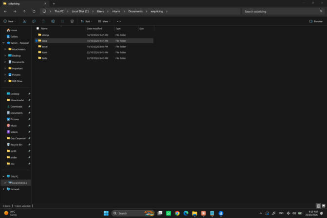

| Folder | Holds |
|---|---|
| `alteryx\workflows\` | The eleven workflows, numbered in run order; `synth\` holds the same workflows wired to the synthetic data |
| `data\input\` | **Your** inputs: the Control workbook and the data files (never committed) |
| `data\output\live\` | **Your** results: checks, results tables, the Results workbook, the run log |
| `data\synthetic\` | A fictional portfolio for testing |
| `excel\templates\` | `XoL_Control.xlsx` and `XoL_Results.xlsx`, the blank templates |
| `tools\` | The batch files that run everything |
| `tests\` | Automated tests (developers) |

The `tools` folder:

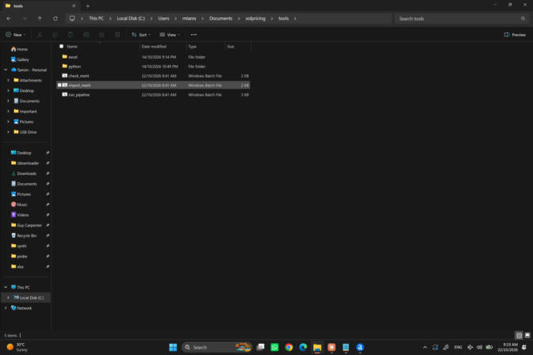

| File | What it does |
|---|---|
| `run_pipeline.bat` | Runs the workflows in order through the Alteryx engine (section 5) |
| `import_merit.bat` | Copies Merit's outputs into the tool's input folder (section 3.3) |
| `check_merit.bat` | Self-test of the Merit route on built-in synthetic data (section 7) |

---

## 2. One-off setup

1. Copy `excel\templates\XoL_Control.xlsx` to `data\input\XoL_Control.xlsx`. This is the workbook you fill in.
2. Copy `excel\templates\XoL_Results.xlsx` to `data\output\live\XoL_Results.xlsx` (the run script does this for
   you if the file is missing). Stage 07 fills its data sheets on every run and keeps your exhibits.
3. Create `data\input\line\`, `data\input\claimant\` or `data\input\ete\` for your data, depending on the input mode
   (section 3).

Try the tool on the synthetic portfolio first: double-click `tools\run_pipeline.bat` with no arguments. It runs the
whole chain on `data\synthetic\` in about a minute and writes to `data\output\synth\`. Section 5 shows what you
see.

---

## 3. Input data

Three input modes. Set the mode with the `source_mode` parameter in the Control workbook.

### 3.1 Line mode (`L`): claim lines and a member list

The simplest route when the cedant gives claim-level data. Two CSV files plus a one-row `run_meta.csv` in
`data\input\line\`. Header-only templates are in `data\templates\`.

**`members.csv`**, one row per member per cover period:

| Column | Required | Content |
|---|---|---|
| member_id | yes | Unique per life, stable across years |
| policy_id | yes | Policy / contract id |
| scheme_id | yes | Employer group / master contract |
| policy_start, policy_end | yes | Policy inception and expiry |
| cover_start, cover_end | yes | The member's own cover dates |
| currency | yes | ISO code of the premium |
| written_premium | yes | Premium for that cover period |
| plan, annual_limit | recommended | Benefit limit (or a plan name looked up in the Control Limits sheet) |
| segment, site | optional | Segmentation; site for per-event grouping |

**`claims_lines.csv`**, one row per claim line, **all claims** (the stop loss needs the full book):

| Column | Required | Content |
|---|---|---|
| claim_line_id, claim_id | yes | Line id; claim id (reversals share it) |
| member_id | yes | Must match `members.csv` (95% or the run stops) |
| treatment_date | yes | Incurred date |
| amount | yes | Payer share, signed |
| status | yes | Paid / Outstanding / Rejected / Reversed (and common synonyms) |
| currency | yes | Transaction currency |
| reported_date, paid_date | recommended | Reported and paid dates |
| event_id, cause_code, admission_date | optional | Per-event cover from experience |

**`run_meta.csv`**: `valuation_date`, `currency_basis`.

Dates `yyyy-mm-dd`, numbers with `.` as the decimal point, UTF-8.

### 3.2 Claimant mode (`C`): large-claimant listing plus aggregates

When only a listing of large claimants is available: `claimants.csv`, `exposure_monthly.csv`,
`claims_aggregate_monthly.csv` and `run_meta.csv` in `data\input\claimant\`. Columns are in
`docs\data-contracts.md` §2.2. This mode has no member-level exposure and no event clustering.

### 3.3 Merit / ETE mode (`E`): Merit's final outputs

When the cedant is already processed by Merit (the interim MR pipeline), the tool reads Merit's final outputs as
they are. Nothing in Merit changes; every further adjustment (trend, completion, limits, layers) is made in the XoL
Control workbook.

A Merit output folder (here a test run) and its `csv` subfolder:

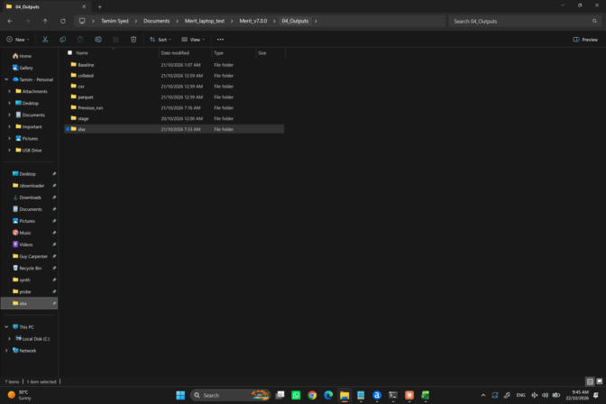

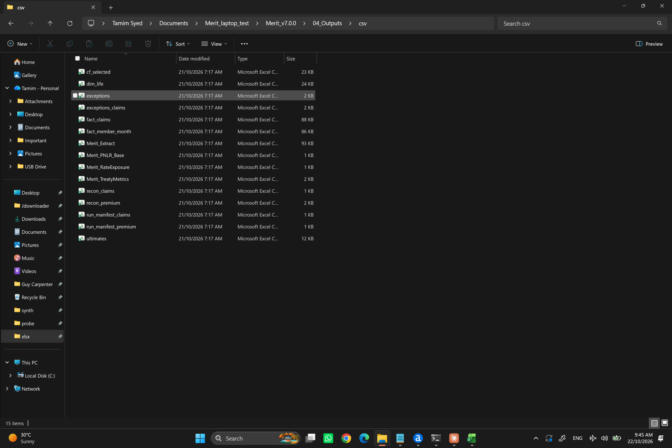

The tool reads four of these files: `dim_life.csv`, `fact_member_month.csv`, `fact_claims.csv` and
`run_manifest_claims.csv`. To copy them in, open a command prompt in the `tools` folder and run

```
import_merit.bat "C:\Merit_Client\04_Outputs"
```

(the path of Merit's output folder; the script finds the `csv` subfolder itself). It copies the four files to
`data\input\ete\` and leaves Merit's folder untouched. Then in the Control workbook set `source_mode = E` and
`ete_payer_filter` to the payer you are pricing (a Merit output can hold several payers).

What the tool does with Merit's data:

| Merit | XoL tool |
|---|---|
| One row per life per underwriting year | Kept as such: a renewing member has one row per year |
| Valuation date in the run manifest | Used as the valuation date. Claims treated after it (Merit's claims extract runs later) are excluded and listed in the checks file |
| Paid and outstanding amounts | Used. Merit's IBNR-completed ultimates are **not** used: your completion factors apply |
| No member-level benefit limits | Limits come from the Control Limits sheet, matched on `Plan / Category` |
| No event fields | Per-event cover is priced from the scenarios you enter (EvScenarios sheet) |
| "Void ab initio" life-periods (blank cover dates) | Kept so their claims count, with no exposure; flagged |

---

## 4. The Control workbook

`data\input\XoL_Control.xlsx` holds every assumption. Alteryx reads each sheet by name; the header is always in
row 4. Yellow cells are inputs; grey cells are written back by Alteryx. Every judgement input has a `justification`
column that is carried into the run log.

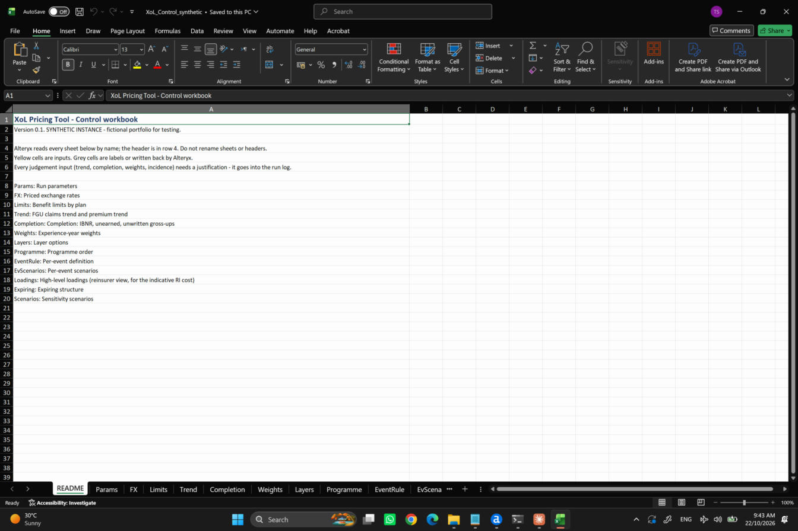

### 4.1 Params

One row per parameter: `param_id`, `value`, with the allowed values and a description beside each. Required
parameters are marked. The run stops (check P01–P04) when a required value is blank, not of the right type, or not
in the allowed list.

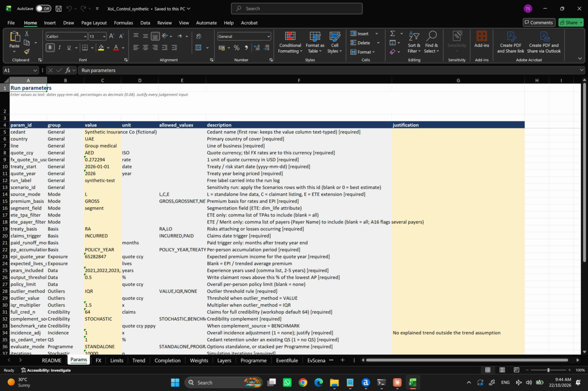

The parameters you will set on every pricing:

| Group | Parameter | Meaning |
|---|---|---|
| General | cedant, quote_ccy, treaty_start, quote_year | The placement; `treaty_start` must be the first of a month |
| Mode | source_mode | L, C or E (section 3) |
| Mode | ete_payer_filter, ete_tpa_filter | Merit mode: which payer / TPAs to price |
| Mode | premium_basis | GROSS, GROSSNET or NET premium for rates and EPI |
| Basis | treaty_basis, claims_trigger, pp_accumulation | RA or LO; incurred or paid; accumulation by policy year or treaty year |
| Exposure | epi_quote_year, expected_lives_quote_year | Expected premium and lives for the quote year |
| Data | years_included | The experience years, 2–5, comma-separated |
| Outliers | outlier_method, outlier_value | VALUE (an amount), IQR or NONE |
| Credibility | full_cred_n | Claims for full credibility (default 64) |
| Incidence | incidence_adj | Overall adjustment to expected claims (1 = none); justify |
| Programme | evaluate_mode | STANDALONE (each option alone) or PROGRAMME (stacked per the Programme sheet) |
| Stochastic | iterations, seed | 10,000 and a fixed seed; both go into the run log |
| Stochastic | severity_source, fit_selected | PYTHON uses the distribution selected in 04a; NATIVE the Pareto; `fit_selected` overrides the selection |
| Cedant impact | net_claims_budget, return_periods, currency_display | Budget for Exhibit C2 (blank = mean simulated gross); return periods; QUOTE or USD |

### 4.2 Layers

Up to four options per cover. `cover` is PP (per person), EV (per event) or SL (stop loss). Per-person and
per-event layers take an attachment point, a limit (or `TO_BENEFIT_LIMIT`), AAD / AAL, co-participation and
reinstatements. Stop losses take `sl_measure` (PCT_BUDGET, PCT_EPI or AMOUNT), the attachment and limit on that
measure, and `sl_claims_basis` (GROSS or NET_OF_XOL). `active = 1` includes the row.

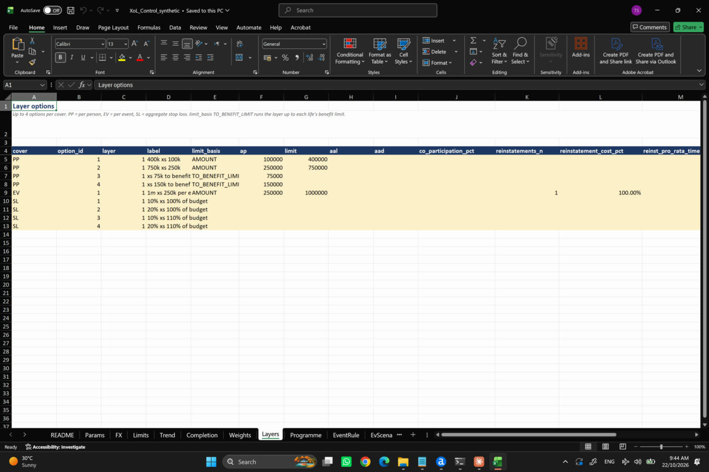

### 4.3 Completion

Multiplicative factors by year, component (IBNR, UNEARNED, UNWRITTEN) and side: PRE_AP applies to each claim before
the attachment point; POST_AP_AMOUNT and POST_AP_COUNT to the layer amount and count after it; ATTRITIONAL to the
total claims used by the stop loss. `ap_band_from` lets a factor vary by attachment point (larger claims settle
more slowly). Alteryx writes an `indicated_factor` beside each unearned / unwritten input as a reference; the value
used is always your `selected_factor`. Read the caveat at the top of the sheet: portfolio development understates
development above an attachment point.

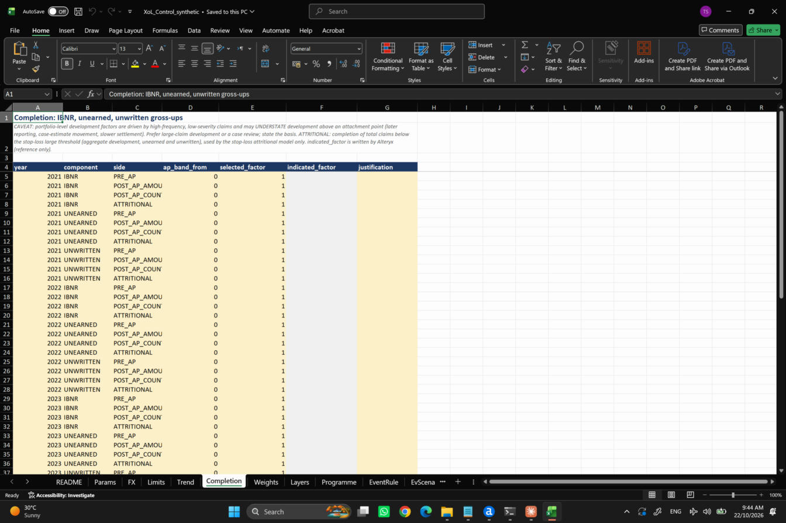

### 4.4 Trend

The from-the-ground-up claims trend by calendar year, as weighted components (client, market, inflation) or a single
residual, with an optional one-off adjustment, a separate large-claim trend and the premium trend.

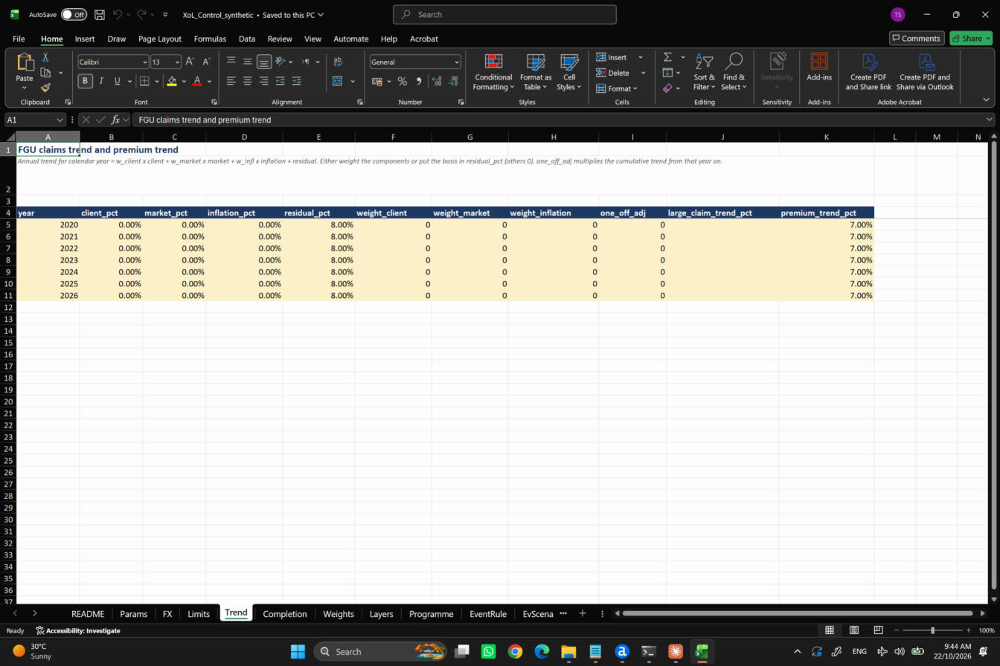

### 4.5 Other sheets

| Sheet | Content |
|---|---|
| FX | Priced rate of each currency in the data to the quote currency |
| Limits | Benefit limit by plan (used when the data has no member-level limit) |
| Weights | Months complete per year; default weights or custom weights with a justification |
| Programme | Order of application when `evaluate_mode = PROGRAMME`: PP → EV → SL, with the option used at each step |
| EventRule | How per-event claims are grouped: supplied event ids, or a clustering rule (window, grouping key, minimum lives) |
| EvScenarios | Named event scenarios: lives, cost per life, return period |
| Loadings | Reinsurer expenses, brokerage, profit margin, premium tax, risk load k, per cover (below) |
| Expiring | The expiring structure and rate, with its recoveries by year, for the comparison exhibit |
| Scenarios | Sensitivity overrides (below) |

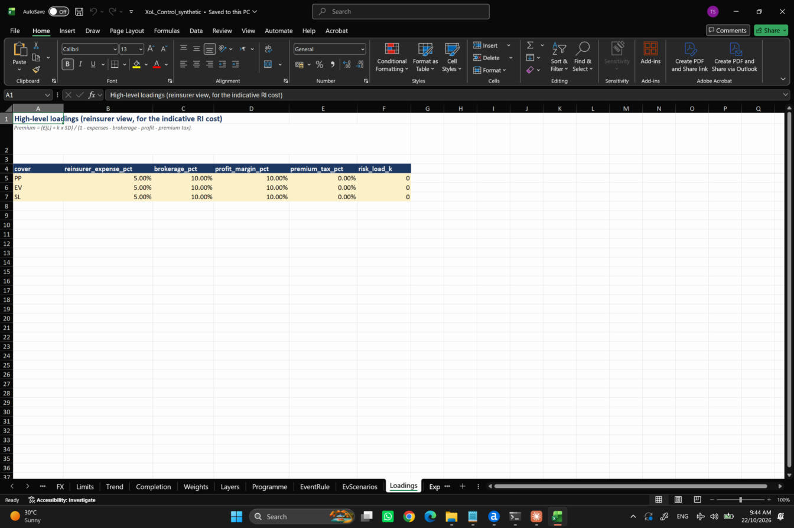

The indicative premium is `(expected loss + k × SD) / (1 − expenses − brokerage − profit − tax)`, net of the
expected reinstatement premium. The loadings can also be overridden on the Results workbook's Inputs sheet without a
re-run.

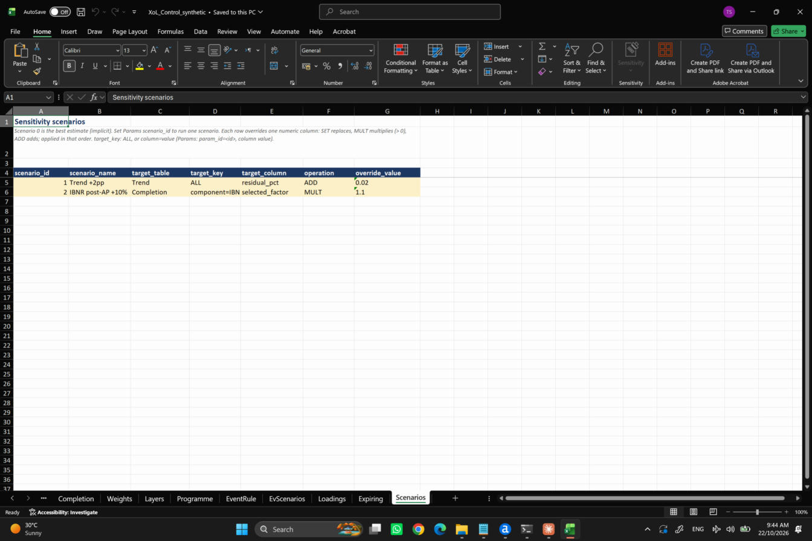

A scenario is a set of rows with the same `scenario_id`, each changing one numeric column of one sheet (`SET`,
`MULT` or `ADD`). Set `scenario_id` in Params to run one; scenario 0 (blank) is the best estimate. Each scenario's
results are kept on the Results workbook's Scenarios sheet.

---

## 5. Running the tool

Everything runs through the Alteryx engine from `tools\run_pipeline.bat`. Designer does not need to be open, and
the Results workbook must be **closed** in Excel.

| Command (from a command prompt in `tools`) | Runs |
|---|---|
| `run_pipeline.bat` | Synthetic data, line adapter, all stages (a double-click does this) |
| `run_pipeline.bat live 01a` | Your data, line mode |
| `run_pipeline.bat live 01b` | Your data, claimant mode |
| `run_pipeline.bat live 01c` | Your data, Merit / ETE mode |
| `run_pipeline.bat live 01a 04a` | From stage 04a onwards (when 00–03 have already run) |
| `run_pipeline.bat live 01c 00 02` | Stages 00 to 02 only |

A window shows each stage as it runs:

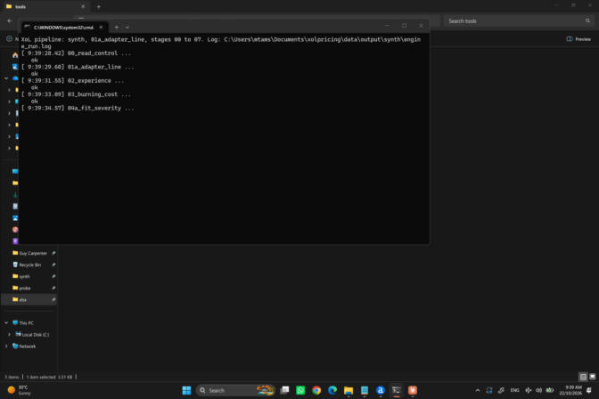

The stages, in order:

| Stage | Workflow | Does |
|---|---|---|
| 00 | Read control | Reads and validates the Control workbook; applies the scenario |
| 01 | Adapter (a, b or c) | Reads your data into the tool's internal tables; data checks |
| 02 | Experience | Treaty years, exposure, indicated completion factors |
| 03 | Burning cost | Trend, completion, caps, layer losses, weights, credibility: the deterministic cost |
| 04a | Severity fit | Fits candidate severity distributions above the threshold (Python) |
| 04 | Simulate | Per-person simulation: frequency, severity, caps, layers, reinstatements |
| 05 | Per event | Event identification, event simulation with scenarios |
| 06 | Stop loss | Attritional model, gross claims, stop loss, programme, cedant-impact inputs |
| 07 | Results | Writes every table to the Results workbook; run log and warnings |

The synthetic chain takes about a minute. The script stops at the first stage that ends with an error, which
includes any STOP check (section 6); the window says which stage and points to the log,
`data\output\<live|synth>\engine_run.log`.

After a run the output folder holds the checks, the results tables, the staging files and the workbook:

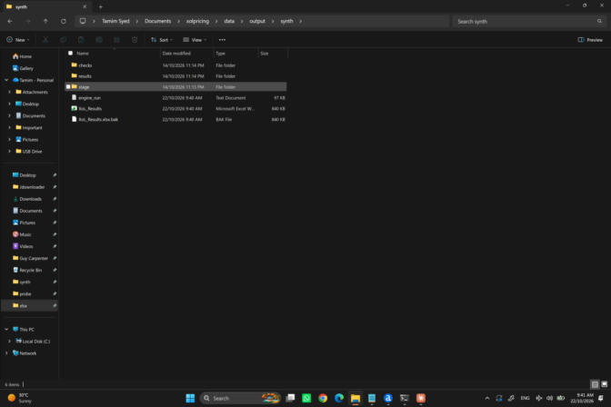

---

## 6. Checks

Every stage writes `checks\checks_NN.csv` with one row per finding:

| Severity | Meaning | What to do |
|---|---|---|
| STOP | The run cannot continue (a required input missing, a match rate below 95%, …) | Fix the input and re-run |
| FLAG | Something to review (claims after the valuation date, low credibility, several payers pooled, …) | Read it; decide whether it changes the pricing |
| INFO | For the record (which severity distribution was selected, …) | — |

The same rows appear on the Results workbook's `out_warnings` sheet, and `checks\recon_NN.csv` carries the control
totals of each stage (rows and amounts in and out), so you can follow every exclusion. The codes are listed in
`docs\data-contracts.md` §6–7.

---

## 7. The Results workbook

Open `data\output\live\XoL_Results.xlsx` after stage 07. Excel recalculates on opening; every exhibit is a formula
over the data sheets, so a change on the Inputs sheet updates everything without a re-run.

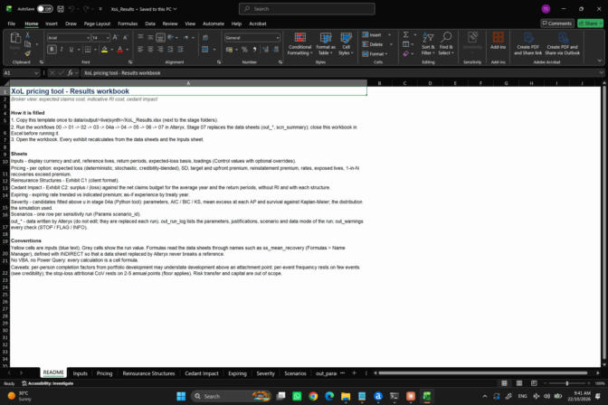

### 7.1 Inputs

Display currency and unit, reference lives, the EPI and net claims budget, the return periods, the expected-loss
basis and the loadings. The "From the run" column shows the Control values; yellow cells override them.

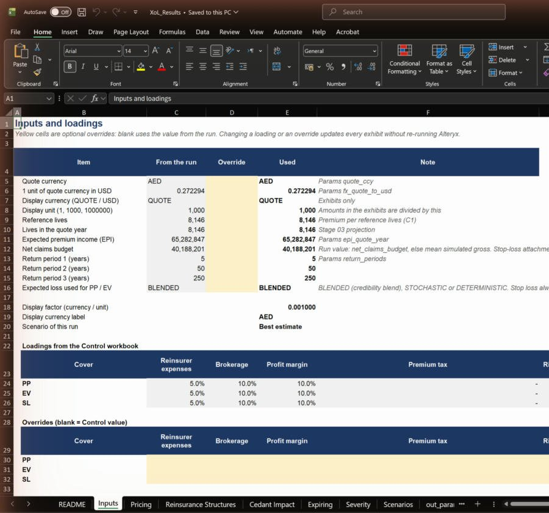

### 7.2 Pricing

One row per option: the deterministic, stochastic and blended expected loss, the SD of annual recoveries, the
loadings, the target premium, the expected reinstatement usage and the upfront premium, the rate per life and as %
of EPI, and the chance that recoveries exceed the premium.

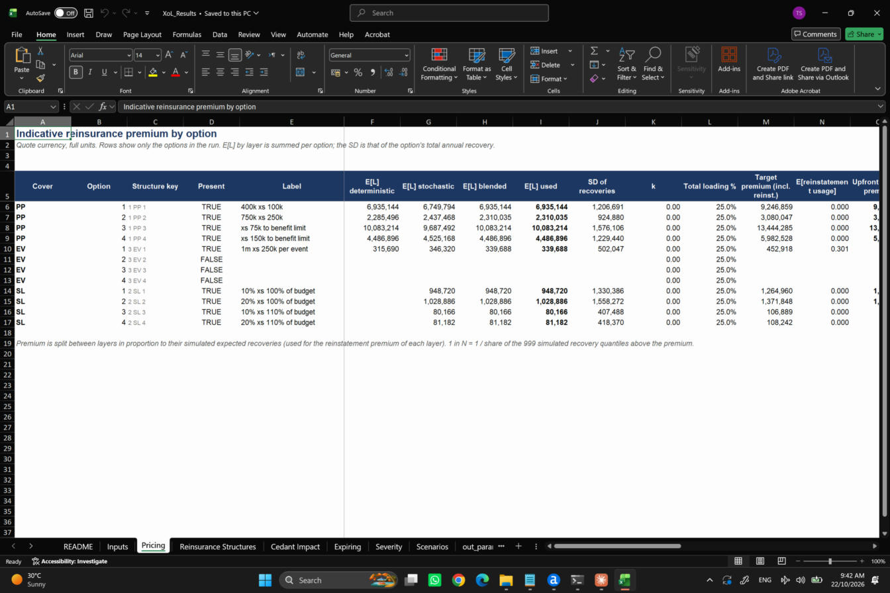

### 7.3 Reinsurance Structures (Exhibit C1)

The client view of each option: exposed lives, premium, premium per exposed life and per reference lives, expected
recoveries, expected cost of cover, and the return period at which recoveries exceed the premium.

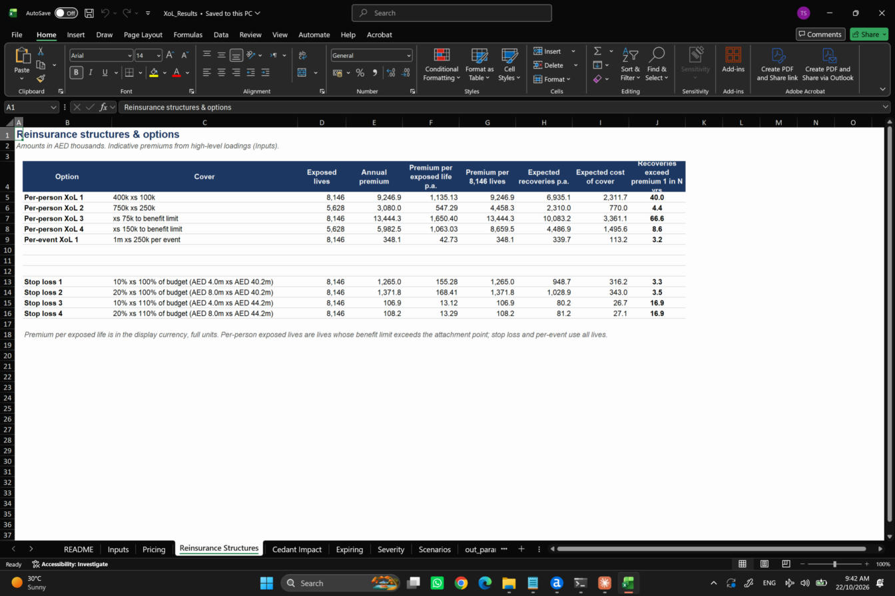

### 7.4 Cedant Impact (Exhibit C2)

The cedant's surplus or loss against the net claims budget, in an average year and at each return period, without
reinsurance and with each structure (and the stacked programme when `evaluate_mode = PROGRAMME`). The workings below
the exhibit show the premiums, mean net claims and quantiles behind each cell.

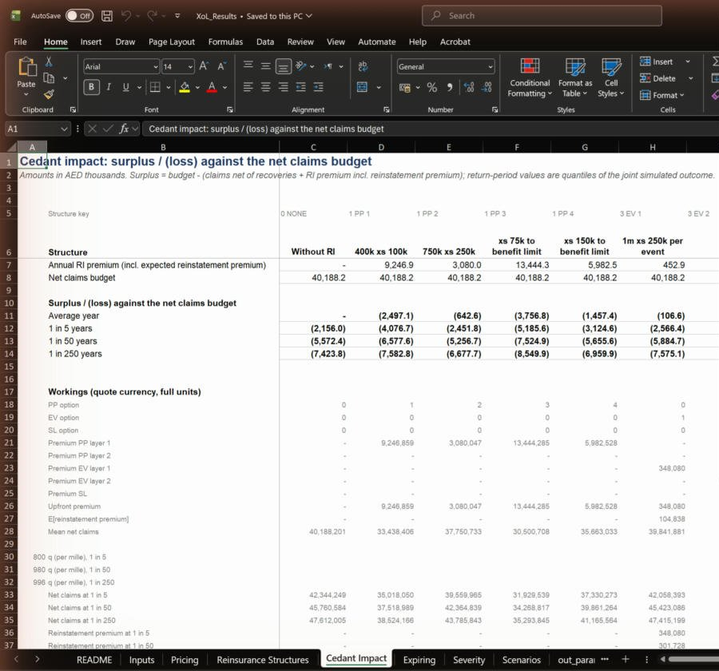

### 7.5 Expiring

The expiring rate trended against the indicated premium of the matching option, and the as-if experience of that
option by treaty year.

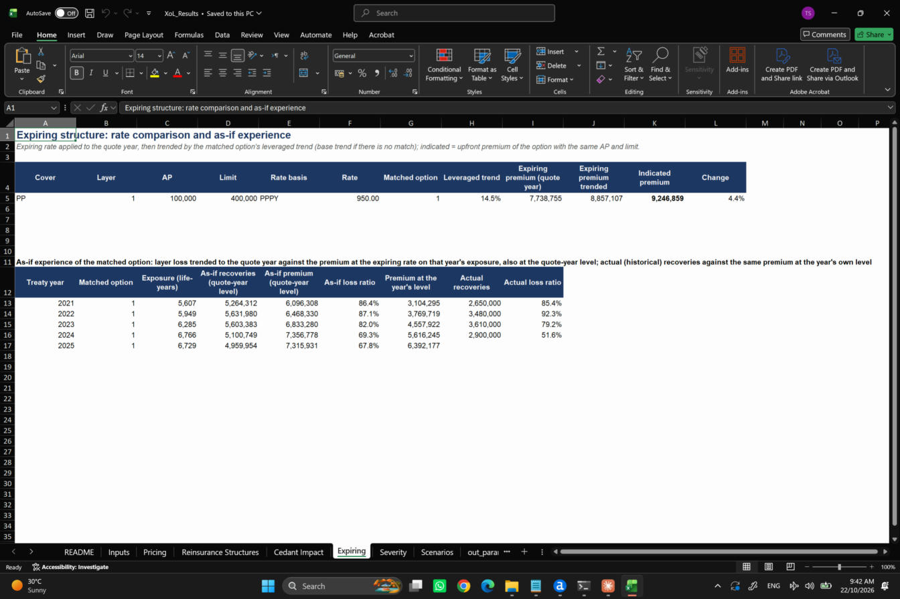

### 7.6 Severity

The candidate distributions fitted in stage 04a: parameters, log-likelihood, AIC, BIC, KS, whether a fit ran to a
boundary, which one was selected and which one the simulation used. Below: the mean excess at each attachment point
(fitted against the data) and the survival at the diagnostic thresholds. Review this sheet before relying on the
stochastic result; override the selection with `fit_selected` in the Control workbook if you disagree with it.

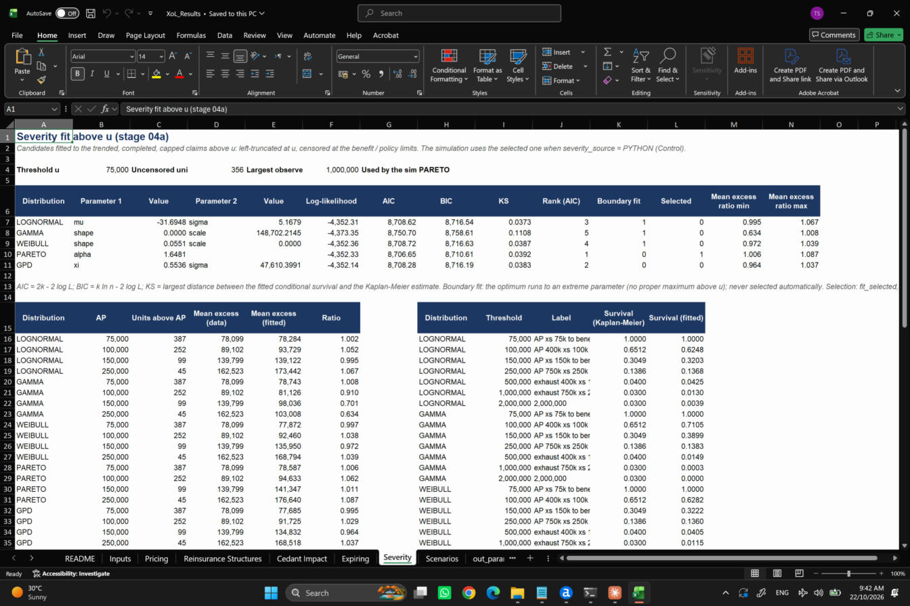

### 7.7 Scenarios

One row per sensitivity run, for the structure chosen in the yellow cell. Runs with different `scenario_id`s
accumulate; a re-run of the same id replaces its rows.

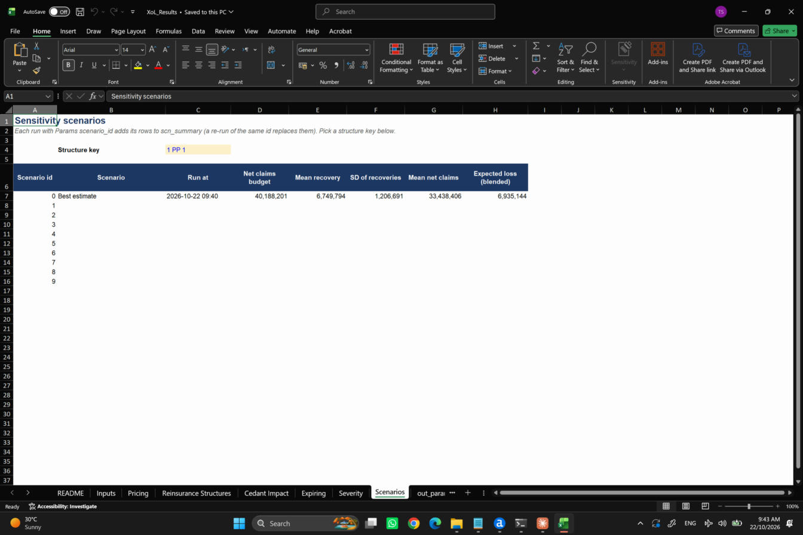

### 7.8 Data sheets

The `out_*` sheets are written by Alteryx and replaced on every run. `out_run_log` lists the tool version, the run
time, every parameter with its justification and the data mode; `out_warnings` every check; `out_recon` the control
totals. Do not edit them.

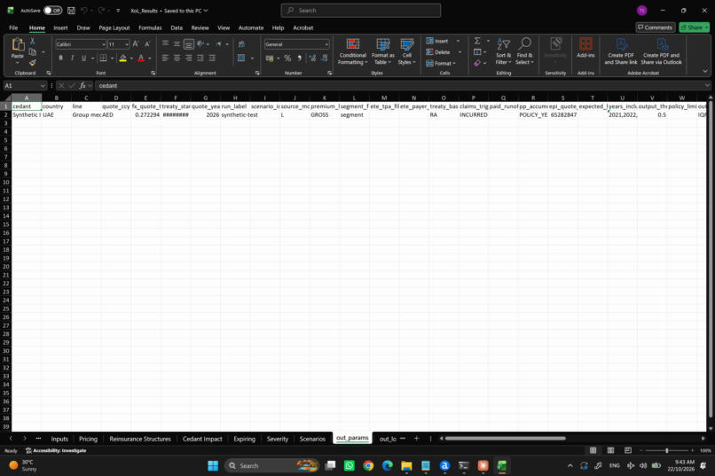

---

## 8. Self-test of the Merit route

`tools\check_merit.bat` runs the Merit route on the synthetic Merit outputs that ship with the tool
(`tests\fixtures\merit_v7`): it places a test Control workbook and the four files in `data\input`, runs stages 00
to 02, removes them again, and then runs the synthetic ETE files through the same stages. It refuses to start when
`data\input` already holds your own Control workbook or data. It takes about half a minute.

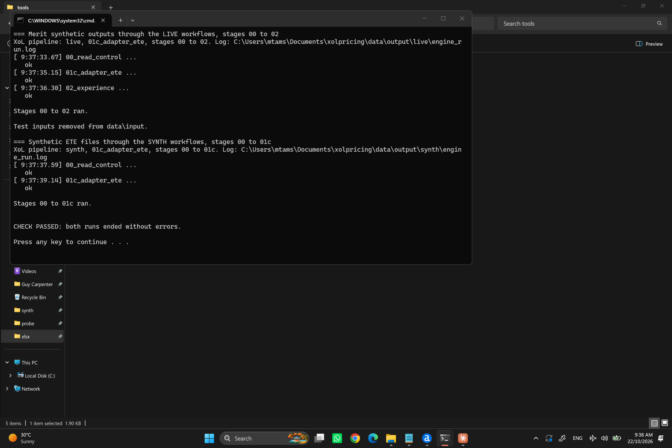

Run it after installing the tool on a new computer, and after a Merit release, before pricing from Merit data.

---

## 9. A pricing, start to finish

1. Get the data in (section 3). For a Merit cedant: run Merit, then `import_merit.bat "<Merit output folder>"`.
2. Fill in `data\input\XoL_Control.xlsx` (section 4). Justify every judgement input.
3. Close the Results workbook if it is open. Run `run_pipeline.bat live 01c` (or `01a` / `01b`).
4. Read `data\output\live\checks\` for STOPs and FLAGs. Fix and re-run if needed.
5. Read `checks\out_completion_indicated.csv`. If you accept the indicated unearned / unwritten factors, copy them
   into the Completion sheet and re-run from stage 00.
6. Open the Results workbook. Review the Severity sheet, then Pricing, C1 and C2. Set the display currency and
   unit and any loading override on the Inputs sheet.
7. For sensitivities: add Scenarios rows, set `scenario_id`, re-run from stage 00; the Scenarios sheet collects them.
8. Save a copy of the Results workbook under the placement's name: stage 07 rewrites the data sheets of the file in
   `data\output\live` on every run.

---

## 10. When something goes wrong

| Symptom | Cause | Fix |
|---|---|---|
| "Alteryx engine not found" | Designer not installed per user, or in another folder | Edit the `ENGINE` line at the top of `run_pipeline.bat` |
| Stage 00 stops with P01–P04 | A required parameter blank, wrong type or not in the list | Fix the Params sheet |
| Stage 01 stops with A03 | Fewer than 95% of claims match a member | Check the member id in both files |
| Stage 04 stops with S07 | `severity_source = PYTHON` but 04a has not run since the last 03 | Run from 04a, or set NATIVE |
| Stage 04a fails on `import scipy` | Designer's Python environment lacks scipy | Set `severity_source = NATIVE` (Pareto fitted natively) and run from 04 |
| Stage 07 "cannot access the file" | The Results workbook is open in Excel | Close it and run from 07 |
| Exhibits show blanks | The workbook was not recalculated, or the run stopped before 07 | Check the log; open the workbook again |
| A sheet is missing from the workbook | A template re-saved by a tool other than Excel | Copy a fresh `excel\templates\XoL_Results.xlsx` |

The run log, `engine_run.log`, holds every message the engine printed, stage by stage.

---

## 11. Where the method is written up

- `docs\methodology.md`: every formula, stage by stage, with its checks.
- `docs\data-contracts.md`: every input column, every output column, every check code.
- `docs\RUNNING.md`: the developer's run guide, including rebuilding the workflows.
- `docs\CHANGELOG.md`: what changed in each version.
